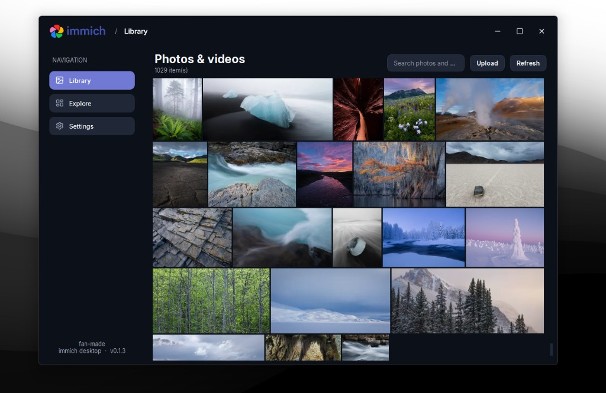

<p align="center">
  
</p>

<h1 align="center">immich desktop</h1>

<p align="center">
  <strong>Unofficial Qt desktop client for Immich</strong><br>
  Browse, search, upload, download, and stream your self-hosted photo library.
</p>

<p align="center">
  <a href="https://github.com/hdmain/immich-desktop/releases/latest"></a>
  <a href="https://github.com/hdmain/immich-desktop/releases/tag/beta"></a>
  <a href="https://github.com/hdmain/immich-desktop/stargazers"></a>
  <a href="https://github.com/hdmain/immich-desktop/network/members"></a>
  <a href="https://github.com/hdmain/immich-desktop/issues"></a>
  <a href="https://github.com/hdmain/immich-desktop/releases"></a>
  <a href="https://snapcraft.io/immich-desktop"></a>
  <a href="https://aur.archlinux.org/packages/immich-desktop"></a>
  <a href="LICENSE.txt"></a>
</p>

> **Unofficial project.** Fan-made desktop client, not affiliated with, maintained by, or endorsed by the official Immich project. Immich is a trademark of its respective owners. This app uses its own branding.

## Showcase



## Features

- **Library** - Immich-style timeline with day groups, Years view, zoomable grids (Ctrl+scroll), and progressive month loading; Home/End or the back-to-top button jump through long grids
- **Explore** - people, places, recently added, and recently viewed media; open a person or place as an in-app Library-style gallery
- **Library sections** - People, Favorites, Archive, Albums, Tags, Folders, and Trash in the sidebar; albums, tags, and folders expand into lists, and the trash can restore or permanently delete
- **Viewer** - step through photos and videos with on-screen controls or arrow keys; optional info panel (date, camera, location, people, albums, tags, folder) that links to those pages
- **Sorting & shuffle** - sort any grid by date taken or added, file size, rating (Immich 3.2+), search relevance, last viewed, or file name and type in folders; each view remembers its own order, albums follow their order in Immich, and Shuffle mixes any view
- **Favorites** - add or remove favorites with the viewer's heart button (or F) or the right-click menu; favorites show a heart on their thumbnail
- **Search** - find photos and videos across your library
- **Folder Sync** - watch multiple local folders and auto-upload new photos/videos to Immich (Windows, macOS, Linux); add another folder with **+**
  - Optional **local-network only** mode: upload only when your Immich Local URL is reachable
  - Unsynced files show in Library immediately with an **unsaved** badge (saving / error icons while uploading)
- **Sharing** - create and copy photo/video share links (optional password) from the context menu or media preview
- **Upload & download** - drag-and-drop, paste, send media to the server, or save it locally (original filename suggested)
- **Video streaming** - built-in player with seek, volume, buffering, and muted hover preview
- **mTLS** - optional client certificate (PKCS#12 or PEM) for Immich behind a reverse proxy
- **Offline mode** - keep browsing with a local thumbnail/disk cache; uploads queue until online
- **Themes** - light, dark, and custom palettes; collapsible sidebar
- **Desktop extras** - system tray, close-to-tray, autostart, single-instance

## Install

### Linux (Snap)

```bash
sudo snap install immich-desktop
```

<p align="center">
  <a href="https://snapcraft.io/immich-desktop">
    
  </a>
</p>

### Arch Linux (AUR)

A community-maintained [`immich-desktop`](https://aur.archlinux.org/packages/immich-desktop)
package builds from source with your system's Qt:

```bash
yay -S immich-desktop   # or any other AUR helper
```

### Other packages

Grab Windows (`.exe` / `.msi`), Linux `.deb`, or AppImage (`x86_64` / `aarch64`)
from the [latest release](https://github.com/hdmain/immich-desktop/releases/latest) (currently **v0.2.4**).
Snap Store ships `amd64` and `arm64`.

## How to run

1. Install Immich Desktop from Snap, the Arch Linux AUR, or a [GitHub release](https://github.com/hdmain/immich-desktop/releases/latest).
2. Open the app and go to **Settings → Immich Server**.
3. Enter your Immich server URL and an API key with permissions such as `user.read`, `asset.read`, `asset.view`, `asset.upload`, `asset.download`, `asset.delete`, and `person.read`, plus optionally `album.read`, `tag.read` and `folder.read` for the Albums, Tags and Folders sections in the sidebar (`album.read` also lists a photo's albums in the info panel), `asset.update` to add or remove favorites, `album.update` to save an album's order back to Immich, and `activity.read` to sort shared albums by recent likes and comments. Optionally set a **Local URL** for LAN use.
4. Test the connection, save, then browse **Library** or **Explore**.
5. (Optional) Open **Settings → Folder Sync**, choose folders with the system file picker (use **+** to add more), enable watching, and turn on **Upload only when Immich is available on the local network** if you only want uploads over LAN. Drop photos or videos into those folders; they appear in Library with sync status badges and upload when allowed. Each folder has its own Browse, Open folder, and Remove controls.

```bash
# Snap or Arch Linux AUR
immich-desktop

# AppImage (x86_64 or aarch64)
chmod +x immich-desktop-x86_64.AppImage   # or immich-desktop-aarch64.AppImage
./immich-desktop-x86_64.AppImage
```

### mTLS / Client Certificates

If your Immich server is behind an mTLS reverse proxy, enable **Client certificate** in **Settings → Immich Server**. The app supports **PKCS#12** (`.p12` / `.pfx`) or **separate PEM certificate + PEM private key**, plus an optional custom CA. The key password can be remembered or prompted when needed. Client certificates apply to the remote server URL only; the optional Local URL connects without them.

### Custom HTTP headers

If a reverse proxy in front of Immich requires extra headers, turn on **Enable custom HTTP headers** under **Settings → Immich Server**. Click **Add header**, enter the name and value, then save. Each header is sent with every request to your Immich server, including requests to the optional Local URL and those made for video playback. They are not sent to third-party CDN or S3 addresses that Immich redirects to. The following header names are reserved by the app and cannot be overridden: `Host`, `Content-Length`, `Transfer-Encoding`, `Connection`, `Range`, and `x-api-key`. Values are stored locally in the app's plaintext settings file.

The same headers are used for both URLs, so do not store secrets here if your Local URL is plain HTTP.

For example, for Cloudflare Access add `CF-Access-Client-Id` and `CF-Access-Client-Secret` with the values from your service token.

## Roadmap

Plans can shift, track progress and ideas in
[Issues](https://github.com/hdmain/immich-desktop/issues).

### Shipped

- Library timeline with search, Years view, zoomable grids, progressive month loading, preview, trash, upload & download
- Shared viewer with photo/video navigation and an info panel (people, places, albums, tags, folder, EXIF)
- Sidebar sections for people, favorites, archive, albums, tags, folders, and trash (view-only for now)
- Favorites: add or remove from the viewer or the right-click menu
- Sorting per view (date taken/added, size, rating, relevance, folder file orders), Shuffle, and a local Recently viewed list (can be turned off)
- Explore: people and places as in-page galleries (Library-style person/place views)
- Folder Sync: multiple watched local folders, LAN-only upload option, unsaved/saving/error badges in Library
- Share links with optional password; mTLS client certificates for reverse proxies
- Custom HTTP headers for reverse-proxy authentication (e.g. Cloudflare Access)
- Video streaming player and hover preview
- Offline browsing via local disk cache + queued uploads when offline
- Themes (light / dark / custom), collapsible sidebar, system tray, autostart, single-instance
- Packaging: Windows installers, `.deb`, AppImage, Snap Store (`amd64` + `arm64`), rolling beta on every `main` push

### Near term

- **Albums & tags** - create albums and tags, add/remove assets, cover photos
- **Bulk actions** - multi-select favorite, archive, download, trash, album assign
- **Upload reliability** - pause/resume, per-file progress, clearer failure recovery
- **Explore polish** - map improvements, people naming/merge hooks, better empty states
- **Keyboard & UX** - more shortcuts and smoother scrolling

### Next

- **Sharing** - album links, partner sharing, richer public URL workflows
- **Memories & faces** - Immich memories feed and richer face/person management
- **Smart library tools** - duplicates, advanced filters (type, camera, date)
- **Notifications** - tray alerts for finished uploads and available updates
- **Sync health** - richer Folder Sync history, last sync time, cache size controls

### Later

- Multi-account / multi-server profiles
- Full-resolution offline packs for selected albums
- External editor / “open with” workflows
- Wider Immich API parity as the server evolves
- Broader packaging (Flatpak) as demand appears

## Looking for collaborators

I'm looking for people who want to co-build this project, and other projects too (mine or yours). Whether you want to contribute to **immich desktop**, start something new together, or get help on your own repo, reach out and let's figure out what to build.

**Contact - Discord:** `diegosanche3` · **GitHub:** [github.com/hdmain/immich-desktop](https://github.com/hdmain/immich-desktop) · **Issues:** [github.com/hdmain/immich-desktop/issues](https://github.com/hdmain/immich-desktop/issues)

Major community contributor: [gardar](https://github.com/gardar) (viewer navigation, zoomable grids, collapsible sidebar, info panel, and more).

Ways to help right now: bug fixes, UX polish, Immich API coverage (albums, sharing, memories), packaging (Flatpak/Snap), and testing on different distros/GPUs. No pressure on scope, small PRs and ideas are welcome too. See `Settings → About` in the app for the full tech stack and links.

## Translations

The interface supports Qt translation catalogs and follows your system language.
Choose **Settings → Appearance → Language** to override it; the interface refreshes immediately.
The app automatically downloads current translations from GitHub at startup and
when selecting a language. A saved copy and embedded catalogs provide offline fallback,
so translation updates do not require a new app build.
English is complete. Polish and Simplified Chinese cover most of the UI (new
library-section strings still need translating); unfinished text falls back to
English. See [the translation guide](translations/README.md) to help translate
or add a language.

<!-- translation-status:start -->

| Language | Code | Progress | Strings |
| --- | --- | --- | ---: |
| English | `en` | `██████████` 100% | 626 / 626 |
| German (Deutsch) | `de` | `██░░░░░░░░` 25% | 159 / 626 |
| French (Français) | `fr` | `██░░░░░░░░` 25% | 159 / 626 |
| Polish (Polski) | `pl` | `█████████░` 87% | 542 / 626 |
| Chinese (简体) | `zh_CN` | `█████████░` 87% | 542 / 626 |

_Auto-generated from `translations/immich_*.ts`. Run `python tools/update_translation_status.py` or `cmake --build build --target update_translations`._

<!-- translation-status:end -->

## Building from source

Requires CMake 3.21+ and Qt 6.2+ (Core, Gui, Widgets, Network, Svg, Multimedia, LinguistTools). Install
`qt6-imageformats` (or your distro's equivalent) at runtime so WebP thumbnails can be decoded.

```bash
cmake -S . -B build -DCMAKE_BUILD_TYPE=Release
cmake --build build
./build/immich
```

Options for distribution packages:

| Option | Default | Purpose |
| --- | --- | --- |
| `IMMICH_ENABLE_UPDATER` | `ON` | Built-in update checks and installs; turn off when a package manager handles updates |
| `IMMICH_EXECUTABLE_NAME` | `immich` | Name of the installed executable (the `.desktop` file follows it) |
| `IMMICH_BUILD_INFO` | empty | Shown after the version, e.g. `AUR` or `beta 1a2b3c4` → "v0.2.4 (AUR)" |

## Project layout

- `src/core` - settings, Immich client, updates, tray helpers
- `src/ui` - shell, pages, and widgets
- `resources` - icons, fonts, desktop metadata
- `snap` - Snap packaging
- `aur` - Arch Linux AUR PKGBUILD, published on each release

## Beta / nightly builds

Every push to `main` rebuilds installers for all platforms and refreshes a rolling
[**beta** prerelease](https://github.com/hdmain/immich-desktop/releases/tag/beta)
(Windows `.exe` / `.msi`, Linux `.deb` / AppImage for `x86_64` + `aarch64`, and Snap).
Snap Store also gets those builds on the `beta` and `edge` channels:

```bash
sudo snap install immich-desktop --beta
# or
sudo snap install immich-desktop --edge
```

Prefer the [latest stable release](https://github.com/hdmain/immich-desktop/releases/latest)
for day-to-day use. Beta builds can break.

| Platform | Download |
| --- | --- |
| All packages (latest beta) | [github.com/hdmain/immich-desktop/releases/tag/beta](https://github.com/hdmain/immich-desktop/releases/tag/beta) |
| Snap (`beta`) | `sudo snap install immich-desktop --beta` |
| Snap (`edge`) | `sudo snap install immich-desktop --edge` |

## Contributing

See [CONTRIBUTING.md](CONTRIBUTING.md). Please follow the
[Code of Conduct](CODE_OF_CONDUCT.md). Security reports go through
[SECURITY.md](SECURITY.md), not public issues.

## User profiles

Switch accounts using the profile menu in the top bar, or manage them under **Settings → Immich Server → User profiles**. Create an empty profile with **New profile**, or fill out the connection form and use **Save as new profile…**. Rename applies to the active profile; **Delete profile…** lets you delete an inactive profile. Choose **Use this profile on launch** to set the startup account independently of the account currently open.

Each profile keeps its own server/local URLs, API key, HTTP headers, client certificate settings, library and image caches, upload queue, download directory, playback/timeline preferences, and folder sync settings/state. Switching stops the previous account's requests and folder watching; its queued uploads resume when you return. Appearance, language, window behavior, and app updates are shared. Existing settings and caches migrate into a **Personal** profile. Deleting a profile removes its saved connection settings; cached files are never assigned to a new profile.

## Star History

<p align="center">
  <a href="https://www.star-history.com/#hdmain/immich-desktop&Date">
    <picture>
      <source media="(prefers-color-scheme: dark)" srcset="https://api.star-history.com/chart?repos=hdmain/immich-desktop&type=date&theme=dark&legend=top-left" />
      <source media="(prefers-color-scheme: light)" srcset="https://api.star-history.com/chart?repos=hdmain/immich-desktop&type=date&legend=top-left" />
      
    </picture>
  </a>
</p>

## License

MIT - see [LICENSE.txt](LICENSE.txt).
